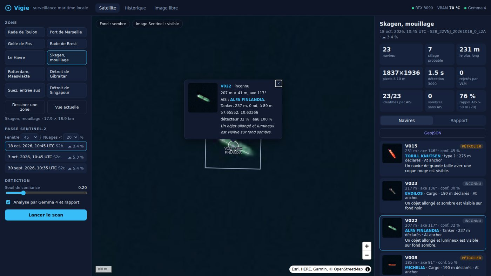

# Vigie

Local maritime surveillance on a single GPU. Vigie pulls the latest cloud-free Sentinel-2 pass, or a Sentinel-1 radar pass that sees through clouds and at night, over an area, finds the ships, measures them, checks them against AIS to flag the ones that stay silent, and has a local vision model write a situation report. It can also show live AIS positions on the map.

Everything runs on one machine. Developed on an RTX 3090, smaller GPUs work, a CPU works slowly. No paid API required.



## What it does

| Step | How |
|---|---|
| Find imagery | STAC search on Element 84's public Sentinel-2 L2A catalog, passes ranked by real footprint coverage then date |
| Read it | windowed HTTP range reads of the 10 m true-colour COG and the SCL water mask, never the full 110 km tile |
| Detect | YOLOv8s fine-tuned on Sentinel-2 (DefendIntelligence weights, MIT), 640 px tiles with overlap, NMS plus containment merge |
| Filter | SCL water mask against land false positives, OpenStreetMap wind turbines, lighthouses and beacons |
| Measure | hull length and axis by PCA on the ship's pixels, hull and wake separated to get a probable course |
| Identify | Danish Maritime Authority open AIS, interpolated to the pass time, Hungarian matching under 500 m |
| Describe | a local vision model looks at each crop, JSON output constrained by schema, then writes a report. Ollama or any OpenAI-compatible server |
| Follow | the same area over several passes, ships that stayed, arrived or left |
| Radar | Sentinel-1 RTC from Microsoft Planetary Computer, log-normal CFAR on CPU, ESA WorldCover land mask plus OSM piers and bridges |
| Live AIS | optional aisstream.io WebSocket feed, current positions on the map |

## Honest numbers

Measured against AIS, which no model in the pipeline has seen.

| Area | Sentinel-2 pass | Detections | Matched to AIS | Recall, AIS ships > 50 m | Length error, median |
|---|---|---|---|---|---|
| Skagen anchorage | 2026-10-18 | 23 | **23 (100 %)** | **76 %** (22/29) | 30 m |
| Five Danish scenes pooled, optical | Sep-Oct 2026 | 95 | 47 (50 %) | 51 % (24/47) | 19 m |
| Same five scenes, radar CFAR | Sentinel-1, same days | 80 | 52 (65 %) | 77 % | 24.5 m |

What the numbers say:

- In open water the detector is precise. Most unmatched detections in narrow straits are small boats under way with a visible wake: pleasure craft are not required to carry AIS.
- Ships moored at a quay are mostly missed. It is the model, not the water mask: removing the mask changes nothing.
- The wake heuristic is weak: at 10 m a white bridge at the stern of an anchored ship looks like a hull followed by a wake. The UI says "probable wake" and trusts AIS speed when it has it.
- The VLM cannot tell a tanker from a bulk carrier at 10 m. With a careful prompt it now mostly answers "unknown" instead of guessing wrong. Identity comes from AIS.

- Radar beats optical on detection with no machine learning at all. Optical keeps the visual description and the wake.

Full tables: [docs/validation-ais.md](docs/validation-ais.md), [docs/validation-sar.md](docs/validation-sar.md). Reproduce with `uv run python scripts/validate_ais.py`.

## Quick start

```bash
git clone https://github.com/Keil-ENZO/vigie.git && cd vigie
uv sync
uv run vigie fetch-model                       # reference Sentinel-2 weights, 22 MB
uv run vigie scan --preset toulon --analyse    # --analyse needs a vision model, see Configuration
uv run vigie serve                             # http://127.0.0.1:8740
```

If Vigie runs on another machine, tunnel the port:

```bash
ssh -L 8740:localhost:8740 <server>
```

Other commands: `vigie scenes <bbox>`, `vigie list`, `vigie analyse <scan_id>`. Radar: `vigie scan-sar --preset skagen`, details in [docs/sar.md](docs/sar.md).

## Layout

```
src/vigie/
  sentinel.py   STAC search, windowed reads, water mask
  tiling.py     tiles and box merging
  detector.py   tiled YOLO inference with a VRAM temperature guard
  morphology.py hull, wake, length, axis, course
  geo.py        pixels to GeoJSON
  infra.py      fixed objects from OpenStreetMap
  sar.py, cfar.py, landmask.py, scan_sar.py  Sentinel-1 radar
  ais.py        Danish AIS, interpolation, matching
  aislive.py    live AIS from aisstream.io
  analyst.py    vision model per ship, then a report
  series.py     one area over several passes
  scan.py       orchestration and on-disk storage
  api.py, cli.py, jobs.py, thermal.py
web/            map UI, no build step
scripts/        AIS evaluation
```

## Configuration

Everything is set through environment variables. All are optional.

### Vision model

Any model that accepts images works. Small models make worse reports, the numbers above come from Gemma 4 26B.

| Variable | Default | Meaning |
|---|---|---|
| `VIGIE_LLM_API` | `ollama` | `ollama` or `openai` for any OpenAI-compatible server |
| `VIGIE_LLM_URL` | `http://localhost:11434`, or `http://localhost:1234/v1` with `openai` | server address |
| `VIGIE_LLM_KEY` | none | API key, only if the server asks for one |
| `VIGIE_VLM` | `gemma4:26b-a4b-it-q4_K_M` | model name, exactly as the server lists it |

Ollama:

```bash
ollama pull qwen2.5vl:7b
VIGIE_VLM=qwen2.5vl:7b uv run vigie serve
```

LM Studio, vLLM or llama.cpp server:

```bash
VIGIE_LLM_API=openai VIGIE_LLM_URL=http://localhost:1234/v1 VIGIE_VLM=<model-id> uv run vigie serve
```

A hosted API, OpenAI or OpenRouter:

```bash
VIGIE_LLM_API=openai VIGIE_LLM_URL=https://openrouter.ai/api/v1 VIGIE_LLM_KEY=... VIGIE_VLM=<model-id> uv run vigie serve
```

With a hosted API, ship crops and scan data leave your machine.

### Other settings

| Variable | Default | Meaning |
|---|---|---|
| `VIGIE_DATA` | `./data` | scans and caches |
| `VIGIE_AIS_DIR` | `$VIGIE_DATA/ais` | Danish AIS daily CSVs, for matching |
| `VIGIE_AISSTREAM_KEY` | none | free [aisstream.io](https://aisstream.io) key for live AIS, or put it in `~/.config/vigie/aisstream.key` |
| `VIGIE_MODEL` | reference weights | detector weights |
| `VIGIE_OVERPASS` | `overpass-api.de` | OpenStreetMap Overpass endpoint |

Never commit a key. Keep it in the environment or in the key file.

### GPU temperature guard

The 3090's GDDR6X heats fast. Every GPU loop calls a guard that pauses at 84 °C VRAM and resumes under 60 °C, read from a node_exporter textfile at `VIGIE_GPUTEMPS_PROM`. Without that file the guard does nothing. Thresholds: `VIGIE_VRAM_PAUSE`, `VIGIE_VRAM_RESUME`. Vigie never touches power limits, fans or clocks.

## Credits

- Starting point: [anisayari/vessel-detection](https://github.com/anisayari/vessel-detection) and the [DefendIntelligence model](https://huggingface.co/DefendIntelligence/vessel-detection), MIT.
- Imagery: Copernicus Sentinel-2 via Element 84 Earth Search, Sentinel-1 RTC via Microsoft Planetary Computer, ESA WorldCover.
- AIS: Danish Maritime Authority open data.
- Fixed objects: © OpenStreetMap contributors.

## Licence

Vigie's own code is MIT. It depends on [Ultralytics](https://github.com/ultralytics/ultralytics), which is AGPL-3.0. If you redistribute Vigie with Ultralytics, or offer it as a network service, AGPL terms apply to that whole.
