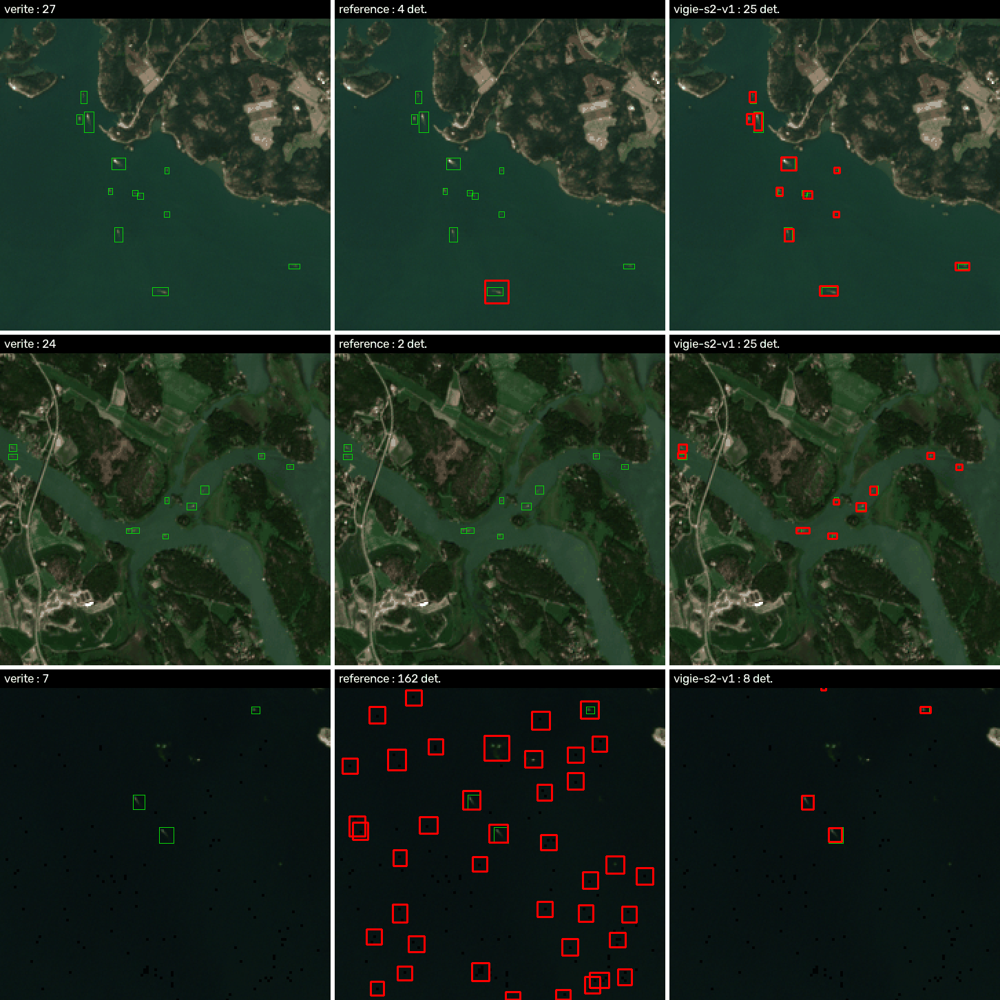
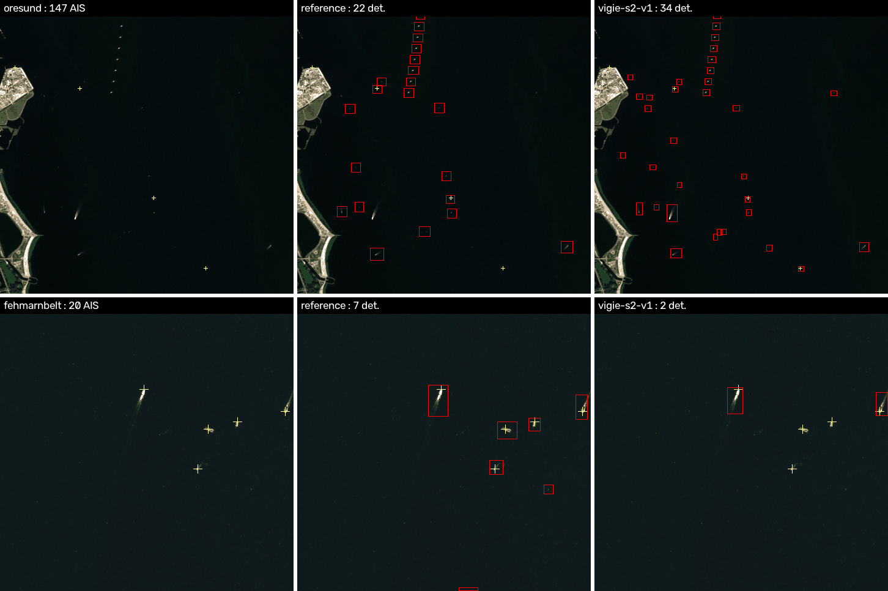

# Entraînement d'un détecteur de navires Sentinel-2

Objectif : entraîner notre propre détecteur sur la 3090 et le comparer honnêtement au modèle de
référence `defendintel-yolov8s-s2.pt`. Livrable : `models/vigie-s2-v1.pt` (gitignoré).

**En bref.** Le modèle livré est bien meilleur que la référence sur les petits bateaux et sur la
mer sombre de la Baltique. Sur l'AIS danois, il trouve plus de navires que la référence au même
seuil, au prix de plus de détections sans AIS. Sa faiblesse : les grands navires au mouillage,
sans sillage, que la référence voit mieux. Ce n'est pas un remplaçant direct, voir les recommandations.

## Données

### Jeu d'entraînement : côte finlandaise (SYKE)

- **Source** : Mäyrä et Jokinen, Institut finlandais de l'environnement, « Dataset for marine vessel
  detection from Sentinel 2 images in the Finnish coast », Zenodo,
  [10.5281/zenodo.10046342](https://doi.org/10.5281/zenodo.10046342).
- **Licence** : CC BY 4.0. Téléchargeable sans compte. Annotations : 5 GeoPackages, 2,3 Mo.
- **Contenu** : 7 911 boîtes sur 15 passes de l'été 2021-2022, 5 tuiles MGRS. Les boîtes couvrent
  le navire **et une partie du sillage**. Annotation à deux experts, objets d'au moins 2 x 2 px.
- **Imagerie** : on ne prend pas leurs mosaïques L1C. On relit les **mêmes passes en L2A, bande
  `visual` (TCI)**, sur le STAC Element 84, c'est-à-dire exactement ce que voit le pipeline.
  15 TCI + 15 SCL en cache, 2,9 Go.
- **Pourquoi lui** : seul jeu trouvé qui coche tout. Sentinel-2 optique, boîtes, licence ouverte,
  géoréférencé donc reprojetable sur notre imagerie. Écartés : xView3 (SAR), le jeu AGENIUM (accès
  restreint, CC BY-NC-SA), ShipS2AIS et les jeux IMT/CLS (positions, pas de boîtes), Kaggle (auth).

### Split géographique

Celui des auteurs pour le test, plus une tuile de validation. Aucune tuile 640 ne passe d'un split
à l'autre.

| Split | Tuiles MGRS | Zone | Passes | Tuiles 640 | Navires |
|---|---|---|---|---|---|
| train | 34VEM, 35VLG | archipel de Turku, golfe de Finlande | 6 | 1 337 (+ 1 337 tournées de 90°) | 8 023 |
| val | 34WFT | baie de Botnie | 3 | 749 | 370 |
| test | 34VEN, 34VER | mer de Botnie, Kvarken | 6 | 828 | 1 389 |

Règles de découpe (`scripts/train/prepare_finnish.py`) :

- Tuiles 640 px, pas de 544 en train, 640 sans recouvrement en val et test.
- On ne garde que les tuiles entièrement dans l'emprise annotée, avec au moins 2 % d'eau SCL.
- 34VEN recouvre 34VEM sur 9,5 km et n'y est pas annotée : toute tuile 34VEN au sud de
  6 700 020 m N est exclue. Sinon, fuite et faux positifs injustes.
- Une boîte coupée par le bord est gardée si au moins 40 % de sa surface reste.
- Train : toutes les tuiles avec navire, 30 % des tuiles vides. Val et test : toutes.

### Ce que le modèle livré a vu en plus

Le premier modèle déclenchait sur le moindre pixel clair en mer ouverte danoise : 1 384 détections
au seuil 0,20 sur trois zones de validation AIS, pour 39 navires. Deux corrections, train seulement :

1. **Variante `big6`** : les navires de moins de 6 px de diagonale, soit moins de 60 m sillage
   compris, sont **effacés par inpainting** et retirés des étiquettes. Ils ne sont pas la cible de
   Vigie, et YOLO n'a pas de zone ignorée. Toutes les tuiles vides sont gardées. 1 951 tuiles,
   5 757 navires, x2 par rotation.
2. **Négatifs durs AIS** (`prepare_ais_negatives.py`) : 99 tuiles L2A de mer ouverte danoise, x2 par
   rotation, sans aucun navire AIS à moins de 500 m de la tuile. Cinq zones : mer du Nord, Skagerrak
   sud et est, Kattegat avec le parc d'Anholt, Kadetrinne. Un garde-fou vérifie qu'aucune ne
   recoupe une zone AIS de val ou de test. Biais : un petit bateau sans AIS y devient négatif.

### Jeux de test complémentaires

- **AIS danois, test** : les cinq cas de `scripts/validate_ais.py` de main (34afc84). Skagen,
  Aarhus, Fredericia, Øresund, Grand Belt. 262 navires AIS, dont 47 de plus de 50 m. Vérité
  indépendante des deux modèles.
- **AIS danois, val** : Fehmarnbelt, Langeland, Frederikshavn. 39 navires AIS, 23 de plus de 50 m.
  Sert au choix du modèle, jamais au rapport final.
- **Ai2 `sentinel2_vessels`, hors domaine** : 2 331 fenêtres mondiales, 8 292 navires, extraites des
  2,5 premiers Go d'un tar public de 52 Go (`fetch_rslearn_sample.py`). Annotations CC BY 4.0.
  Étiquettes **ponctuelles** et imagerie **L1C**. Seules les métriques « centre » y ont un sens.
  On ne sait pas si DefendIntelligence a entraîné dessus.

Disque : 30 Go sous `data`, dont 13 Go d'AIS déjà là et 4,7 Go de jeux.

## Protocole

### Métriques (`scripts/train/evaluate.py`)

Même code pour tous les modèles, NMS à IoU 0,45 comme `vigie.detector`, prédictions à partir de 0,001.

- mAP50 et mAP50-95, interpolation COCO 101 points.
- Précision, rappel, F1 au seuil 0,20 du pipeline, et au meilleur F1.
- **Critère « centre »** : une prédiction est juste si son centre tombe dans une boîte vraie libre.
  Il ne dépend pas de la convention de boîte. C'est important ici : les boîtes SYKE incluent le
  sillage, celles de la référence non. Le mAP par IoU pénalise donc la référence pour une raison
  de convention, le critère centre non.

AIS (`scripts/train/eval_ais.py` et `scripts/validate_ais.py` de main) : appariement optimal
détection ↔ position AIS interpolée à l'heure de la passe, seuil 500 m. La « précision AIS » est
une **borne basse** : un bateau sans AIS compte comme faux positif.

### Entraînements (`scripts/train/train.py`)

YOLO11s et YOLOv8s, AdamW, lr cosinus, 640 px, batch 12, `cache=ram`, `workers=6`, `nice -n 10`.
Augmentations : flips horizontal et vertical à 0,5, rotations de 90° hors ligne, pas de rotation
libre qui gonflerait les boîtes, échelle ±0,3, HSV faible, mosaic 1,0 coupée sur les 10 dernières
époques, ni mixup ni copy-paste.

| Run | Départ | Train | Époques | Calcul GPU | Pauses thermiques |
|---|---|---|---|---|---|
| A `a_y11s_coco` | YOLO11s COCO | finlandais | 60 | 18 min | 26, 21,5 min |
| B `b_v8s_ref` | poids de la référence | finlandais | 52, arrêt anticipé | 13 min | 20, 14,8 min |
| C `c_y11s_big6neg` | YOLO11s COCO | big6 + négatifs AIS | 45 | 22 min | 26, 19,8 min |

Total : environ 53 min de GPU, 1 h 50 au mur. VRAM : 3,9 à 4,3 Go. Température VRAM maximale
lue : 86 °C, la garde coupe à 84 °C et reprend sous 60 °C, après 40 à 75 s. Callback
`vigie.training.ThermalGuard` sur `on_train_batch_end`, `on_val_batch_end` et
`on_train_epoch_start`, testé dans `tests/test_training.py`.

Pourquoi COCO plutôt que la référence comme départ : B, parti des poids de la référence, fait moins
bien que A sur toutes les validations. Les poids de la référence n'apportent rien sur ce jeu.

### Choix du modèle, sur la validation seulement

| Modèle | Val finlandaise mAP50 | AP centre | AIS val @0,20 : détections / appariées / > 50 m |
|---|---|---|---|
| référence | 0,002 | 0,032 | 35 / 17 / 13 sur 23 |
| A | 0,727 | 0,786 | 1 384 / 20 / 14 sur 23 |
| B | 0,680 | 0,771 | 1 337 / 20 / 14 sur 23 |
| **C** | **0,735** | **0,820** | 64 / 9 / 8 sur 23 |

C est retenu : meilleur sur la val finlandaise et le seul de nos modèles utilisable en mer ouverte.
Mais la validation AIS montre déjà sa faiblesse : 8 grands navires trouvés sur 23, contre 13 pour
la référence. Les 8 de Frederikshavn sont à quai, aucun modèle ne les voit.

## Résultats sur les tests

### Test finlandais : 828 tuiles, 1 389 navires

| Modèle | mAP50 | mAP50-95 | P@0,20 | R@0,20 | F1@0,20 | AP centre | P centre@0,20 | R centre@0,20 | F1 centre max (seuil) |
|---|---|---|---|---|---|---|---|---|---|
| référence | 0,003 | 0,000 | 0,009 | 0,025 | 0,013 | 0,041 | 0,072 | 0,203 | 0,122 (0,31) |
| A | 0,768 | 0,291 | 0,528 | 0,844 | 0,649 | 0,886 | 0,592 | 0,947 | 0,824 (0,41) |
| B | 0,730 | 0,250 | 0,551 | 0,794 | 0,650 | 0,887 | 0,631 | 0,910 | 0,825 (0,38) |
| **vigie-s2-v1 (C)** | **0,728** | **0,269** | **0,590** | **0,794** | **0,677** | **0,880** | **0,676** | **0,911** | **0,834 (0,39)** |

Rappel centre au seuil 0,20, par taille de boîte vraie : petits, moins de 8 px, 0,09 pour la
référence contre 0,86 pour C. Moyens, 8 à 20 px : 0,36 contre 0,99. Grands, plus de 20 px, 24
navires seulement : 0,75 contre 1,00.

Lecture honnête : ce test est dans le domaine de nos modèles, pas de la référence. Côte, été,
plaisance, convention de boîte avec sillage. La référence y produit aussi 3 900 faux positifs, dont
une grande partie sur une seule passe sombre du 2022-08-13 où elle déclenche sur les pixels noirs
du L2A. Voir la 3e ligne de la figure ci-dessous. Même en critère centre, l'écart reste énorme.



### Test AIS danois : `scripts/validate_ais.py` de main, seuil 0,20, filtre OSM compris

| Modèle | Détections | Appariées AIS | Précision AIS, borne basse | Rappel > 50 m |
|---|---|---|---|---|
| référence | 116 | 48 | 41 % | 51 % (24/47) |
| A | 567 | 97 | 17 % | 62 % (29/47) |
| B | 428 | 90 | 21 % | 64 % (30/47) |
| **vigie-s2-v1 (C)** | **273** | **85** | **31 %** | **62 % (29/47)** |

Erreur de longueur médiane : 19,5 m pour la référence, 21,5 m pour C, biais +5 m contre +8,5 m.
C mesure un peu long, logique avec des boîtes apprises sillage compris.

Balayage de seuil sur les mêmes zones (`eval_ais.py --set test`, sans le filtre OSM) :

| Modèle | Seuil | Détections | Appariées | Préc. AIS | Rappel > 50 m | Rappel > 100 m |
|---|---|---|---|---|---|---|
| référence | 0,20 | 116 | 48 | 0,41 | 24/47 | 20/31 |
| vigie-s2-v1 | 0,20 | 297 | 88 | 0,30 | 29/47 | 24/31 |
| vigie-s2-v1 | 0,40 | 196 | 74 | 0,38 | 25/47 | 21/31 |
| vigie-s2-v1 | 0,50 | 148 | 65 | 0,44 | 24/47 | 20/31 |

À précision AIS égale, seuil 0,50 contre 0,20, C trouve autant de grands navires que la référence
et 35 % de navires AIS en plus, surtout petits et moyens. Ce seuil est lu sur le test, il est donc
indicatif, pas validé.

Par zone, au seuil 0,20 : Skagen, au mouillage, 21 grands navires sur 29 pour C, 22 pour la
référence. Øresund : 58 navires appariés pour C, 21 pour la référence. Grand Belt : 34 détections
pour C contre 9 : le premier modèle y déclenchait sur les éoliennes de Sprogø, C en garde une partie.



La figure montre les deux visages du modèle. À Øresund, en haut, C trouve les bateaux en route avec
sillage que la référence rate. Les deux déclenchent sur la ligne d'éoliennes de Middelgrunden, que
le filtre OSM de main doit écarter. À Fehmarnbelt, en bas, zone de validation, C rate trois grands
navires compacts sans sillage, que la référence voit.

### Hors domaine : Ai2 `sentinel2_vessels`, 8 593 tuiles, 8 292 navires, critère centre

| Modèle | AP centre | P@0,20 | R@0,20 | F1 max (seuil) |
|---|---|---|---|---|
| référence | 0,323 | 0,616 | 0,259 | 0,415 (0,07) |
| A | 0,279 | 0,241 | 0,448 | 0,355 (0,39) |
| **vigie-s2-v1 (C)** | **0,402** | 0,476 | 0,431 | **0,454 (0,24)** |

Ces chiffres sont bas pour tout le monde. Étiquettes ponctuelles, carré fixe de 150 m autour du
point, imagerie L1C, et des navires que l'annotateur Ai2 a vus et que ni l'un ni l'autre ne voit.
On ne les lit qu'en relatif : C fait mieux que la référence sur un jeu mondial qu'aucun de nos
modèles n'a vu.

## Limites

- **Domaine d'entraînement étroit** : une côte, l'été, surtout de la plaisance en route. Peu de
  grands navires au mouillage. C rate des cargos compacts sans sillage, voir Fehmarnbelt.
- **Convention de boîte** : sillage compris, donc boîtes plus grandes que la référence et
  longueurs surestimées d'environ 3 m de plus en médiane. Le mAP par IoU entre les deux modèles
  n'est pas comparable, d'où le critère centre.
- **Imagerie** : annotations faites sur L1C, imagerie L2A. Décalage radiométrique assumé.
- **Négatifs AIS** : un bateau sans AIS dans une tuile négative a été appris comme fond.
- **Petits échantillons AIS** : 47 grands navires en test, 23 en val. Un écart de 2 ou 3 navires
  n'est pas significatif. La val et le test AIS ne vont pas dans le même sens pour les grands
  navires : 8 contre 13 sur 23 en val, 29 contre 24 sur 47 en test.
- **Choix du seuil** : 0,20 est celui du pipeline. Le seuil 0,4-0,5 suggéré plus haut vient du test.
- **Bug trouvé dans `scripts/validate_ais.py` de main** : `--model` est ignoré.
  `detector.detect(..., model_path=DEFAULT_MODEL)` lie sa valeur par défaut à l'import, réassigner
  `detector.DEFAULT_MODEL` ensuite ne change rien. Tous les chiffres ci-dessus ont été produits avec
  `VIGIE_MODEL=<chemin>` en plus de `--model`, et le nom du modèle a été vérifié dans chaque
  `scan.json`. Correction simple : `model_path: Path | None = None`, puis
  `model_path or DEFAULT_MODEL` dans le corps.

## Prochaines pistes

1. **Fusion des deux modèles** : union des boîtes de la référence et de C, puis la fusion
   `tiling.merge` existante. La référence apporte les grands navires compacts, C les bateaux en
   route. À valider sur la val AIS avant le test.
2. **Plus de grands navires au mouillage** : le jeu Ai2 complet, 52 Go, a 37 000 navires mondiaux
   en points. Transformer les points en boîtes par une segmentation locale, ou entraîner une tête
   de points, puis l'ajouter au train.
3. **Val AIS plus grande** : 10 à 20 passes danoises sur d'autres dates, pour choisir le seuil
   sans toucher au test. L'AIS danois se télécharge jour par jour.
4. **Négatifs durs ciblés** : éoliennes, phares, bouées, pixels noirs du L2A. Ou un filtre
   post-détection qui croise OSM avant le seuil.
5. **Boîtes sans sillage** : réannoter une partie du jeu finlandais coque seule, ou apprendre deux
   classes, coque et sillage. La longueur mesurée y gagnerait.

## Reproduire

```bash
uv run python scripts/train/prepare_finnish.py                       # jeu de base, ~10 min
uv run python scripts/train/prepare_finnish.py --variant big6 --keep-empty 1.0 --min-diag 6
uv run python scripts/train/prepare_ais_negatives.py                 # négatifs AIS
uv run python scripts/train/fetch_rslearn_sample.py --max-bytes 2.5e9 && \
  uv run python scripts/train/prepare_rslearn_points.py              # test hors domaine
nohup nice -n 10 uv run python scripts/train/train.py --name c_y11s_big6neg --model models/yolo11s.pt \
  --data data/datasets/finnish_big6_neg.yaml --epochs 45 > runs/train/c.log 2>&1 &
uv run python scripts/train/evaluate.py --data .../finnish/data.yaml --split test --weights A.pt B.pt
uv run python scripts/train/eval_ais.py --set val --weights A.pt B.pt
```

`finnish_big6_neg.yaml` liste deux dossiers de train, `finnish_big6/images/train` et
`ais_negatives/images/train`, avec la val et le test du jeu de base. Tous les chiffres sont
dans `docs/entrainement-resultats.json`.
