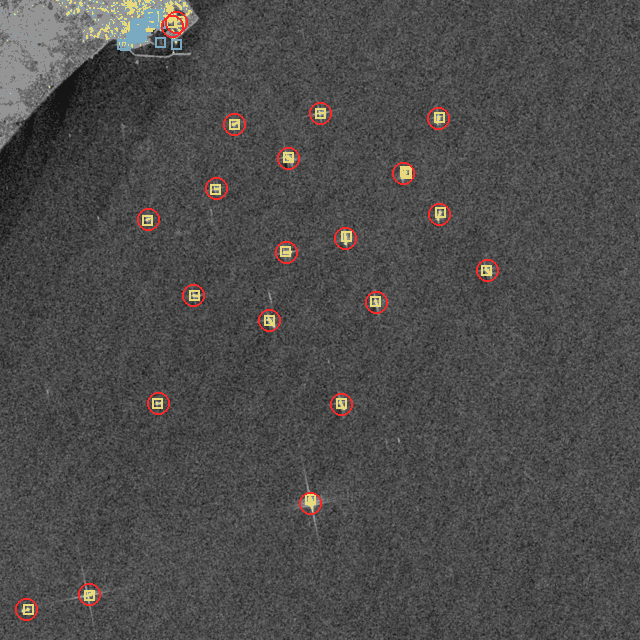

# Radar Sentinel-1 : les navires de nuit et sous les nuages

L'optique Sentinel-2 ne voit rien la nuit ni sous un ciel couvert, soit la moitié de l'année au Danemark. Le radar Sentinel-1 émet sa propre onde en bande C et la traverse. Un navire en acier la renvoie comme un coin de réflecteur, de 10 à 45 dB au-dessus de la mer. Pas besoin d'apprentissage : un seuil adaptatif suffit.

```
uv run vigie scenes-sar --preset skagen          # passes disponibles
uv run vigie scan-sar --preset skagen            # dernière passe
uv run vigie scan-sar --preset skagen --scene S1C_IW_GRDH_1SDV_20261018T170105_20261018T170130_009942_013D1F_rtc
uv run python scripts/validate_sar.py --figure   # validation AIS, ce document
```

Route HTTP : `POST /api/scans-sar`, même corps que `POST /api/scans`, rend une tâche. Il reste à l'inclure dans `api.py` avec `app.include_router(sar_api.router)`.

## Sortie

Un scan radar écrit le même dossier qu'un scan optique, dans `data/scans/<id>/`. La carte, `ais.crosscheck` et l'analyste le lisent sans changement.

- `scan.json` : les clés de l'optique, plus `"sensor": "sentinel-1"`, `"transform"` (la géoréférence de la fenêtre) et `"cfar"` (statistiques du fond). `scene.cloud_cover` vaut 0 : le radar traverse les nuages.
- `detections.geojson` : les propriétés de l'optique. `course_deg` et `wake_m` sont toujours nuls et `underway` faux, faute de sillage lisible à 10 m. S'y ajoutent `sensor`, `peak_db`, `contrast_db`, `vh_contrast_db` et `pixels`. `confidence` est une pseudo-confiance tirée du contraste : 0,5 au seuil, 0,9 vers 30 dB.
- `image.jpg` : fausse couleur classique, rouge VV, vert VH, bleu VV/VH. La mer sort violette, la végétation verte, les navires blancs.
- `crops/V001.png` : chaque navire agrandi, comme pour l'optique.

## Source : RTC plutôt que GRD

Les deux viennent du STAC du Microsoft Planetary Computer. Les URL se signent anonymement par `https://planetarycomputer.microsoft.com/api/sas/v1/sign`. Aucun compte n'est requis, et aucune dépendance n'a été ajoutée.

| | `sentinel-1-grd` | `sentinel-1-rtc`, retenu |
|---|---|---|
| Géométrie | radar, géoréférencée par une grille de GCP | UTM, pas de 10 m, comme Sentinel-2 |
| Valeurs | comptes numériques, calibration à faire | gamma0 calibré, en intensité linéaire |
| Lecture d'une zone | trouver la fenêtre radar, puis reprojeter | fenêtre COG en HTTP Range, le code de `sentinel.py` |
| Délai | NRT, environ 3 h | disponible le même jour sur les passes testées |

Le RTC donne la même grille que l'optique, sans rééchantillonnage. Sa correction de relief ne sert à rien en mer, mais elle ne gêne pas. Une fenêtre de 0,3° sur 0,17° se lit en 2 à 4 s, VV et VH compris.

Le GRD reste en repli dans `sar.load`, si une passe n'a pas de RTC. Un plan ajusté sur les GCP voisins donne la fenêtre radar utile. On la lit seule, puis `rasterio.warp.reproject` la projette par les GCP décalés. Sur Skagen le 2026-10-18, les 15 cibles les plus fortes tombent à 26 m médians de leur position RTC. Les GCP du GRD sont posés sur l'ellipsoïde, alors que le RTC passe par un MNT.

## Détecteur : CFAR log-normal sur VV et VH

`cfar.py`. Pour chaque pixel, on regarde un anneau autour de lui : 81 px de côté, moins une garde de 31 px qui contient un navire entier. On y mesure la moyenne μ et l'écart-type σ de la mer, en dB. Le pixel devient candidat si :

- `x_dB > μ + 4,5 σ` ;
- `x_dB − μ > 8 dB`.

En dB, le chatoiement de la mer suit à peu près une gaussienne : c'est le modèle log-normal. Le modèle K colle mieux aux queues par mer forte, mais il faut estimer une forme par fenêtre. Ici, trois filtres moyenneurs suffisent, soit environ 1 s pour 3,5 Mpx sur CPU, et l'écart minimal en dB rattrape les fausses alarmes du modèle simple. Le fond est estimé deux fois : la seconde passe retire les cibles de la première, pour qu'un navire voisin ne gonfle pas σ. Les pixels hors fauchée ou à terre n'entrent jamais dans le fond.

VV et VH sont testés chacun de leur côté, puis on garde l'union. En VH, la mer tombe au plancher de bruit, vers −26 dB. Un navire y garde de 20 à 35 dB de contraste. Les cibles vues seulement en VH sont pourtant surtout du bruit, à l'Øresund comme au Grand Belt. Une cible doit donc atteindre un pic de 13 dB en VV, ou de 18 dB en VH.

On regroupe ensuite en composantes connexes, après une dilatation d'un pixel qui recolle une coque morcelée, puis on filtre :

- au moins 2 pixels ;
- au plus 450 m de long ;
- une cible de plus de 150 m doit ressortir de 20 dB. Un vrai cargo est une montagne d'acier. Une longue cible pâle est une digue oubliée ou un front de houle.

**Mesure.** L'idée de `morphology.measure` est reprise : l'ACP des pixels donne l'axe, et la longueur vaut `sqrt(12 λ1)`. Un réflecteur fort dessine toutefois une croix de lobes secondaires le long des axes de l'image, sur plusieurs centaines de mètres. On ne garde donc que les pixels à moins de 12 dB du pic. La mesure se fait en VH quand la cible y dépasse 15 dB, car les lobes y restent sous le bruit. On retire enfin 20 m, une cellule de résolution du GRD IW : la réponse impulsionnelle étale chaque coque. Le centre est le barycentre pondéré par l'intensité, donc le pic, pas le milieu des lobes.

## Masque terre

Le CFAR s'allume partout à terre. Le masque SCL de Sentinel-2 demande une passe sans nuages, ce que le radar cherche justement à éviter. `landmask.py` combine donc deux sources :

1. **ESA WorldCover 2021**, en COG sur le Planetary Computer : 10 m, mondial, classe 80 pour l'eau. On lit la seule zone, reprojetée sur la grille du radar par `WarpedVRT`, puis gardée en cache dans `data/landmask-cache/`. On rogne 30 m le long des côtes. Hors tuile, au large, on compte de l'eau.
2. **Les ouvrages d'OpenStreetMap**, par Overpass, en cache. On prend les digues, jetées, épis et quais élargis de 30 m, et les ponts élargis de 120 m. WorldCover classe une digue de 15 m en eau, et le radar la voyait comme un navire sombre de 230 m à Skagen. Un tablier de pont à 50 m de haut se replie vers le radar de `h / tan(θ)`, soit 70 à 90 m en IW. Sans cette marge, le pont de l'Øresund donnait des navires.

`infra.flag` marque ensuite les éoliennes, phares et balises, sans changement. Il en écarte 65 sur les sept passes, surtout à Middelgrunden et au Grand Belt.

Les quais et bassins sont classés bâti dans WorldCover. Un navire à quai est donc masqué. C'est voulu : à 10 m, les grues et les piles de conteneurs ressemblent trop à des navires pour le radar.

## Validation AIS

AIS ouvert de l'Autorité maritime danoise, `ais.crosscheck` tel quel : appariement optimal à moins de 500 m, positions AIS interpolées à l'heure de la passe. Les passes radar tombent vers 05:25 UTC en orbite descendante et vers 17:00 UTC en orbite ascendante. L'optique passe vers 10:30. Les flottes ne sont donc pas les mêmes à l'heure près, mais les jours et les zones le sont.

Les seuils ont été réglés sur deux passes, Skagen et l'Øresund le 2026-09-30, puis figés. Les cinq passes du tableau principal n'ont pas servi au réglage.



### Passes du même jour que l'optique, non vues au réglage

| Zone | Passe S1, UTC | AIS | AIS > 50 m | Détections | Appariées | Sombres | Précision | Rappel > 50 m | Rappel > 50 m, eau libre | Longueur, err. méd. |
|---|---|---|---|---|---|---|---|---|---|---|
| Skagen, mouillage | 2026-10-18 17:01 | 74 | 27 | 21 | 21 | 0 | 100 % | 78 % | 19/20 | 12 m |
| Aarhus, baie | 2026-10-18 17:00 | 28 | 8 | 13 | 8 | 5 | 62 % | 50 % | 1/1 | 73 m |
| Fredericia, Petit Belt | 2026-10-18 17:00 | 11 | 2 | 4 | 4 | 0 | 100 % | 50 % | 1/2 | 101 m |
| Øresund, Copenhague | 2026-09-27 05:24 | 123 | 7 | 33 | 15 | 18 | 46 % | 100 % | 5/5 | 40 m |
| Grand Belt, pont | 2026-09-30 17:00 | 5 | 4 | 9 | 4 | 5 | 44 % | 100 % | 4/4 | 20,5 m |
| **Radar S1, total** | | 241 | 48 | 80 | 52 | 28 | **65 %** | **77 %** | **94 %** | 24,5 m, biais +10,5 m |
| *Optique S2, total* | | 262 | 47 | 95 | 47 | 48 | 50 % | 51 % | – | 19 m, biais +5 m |

Skagen le 2026-10-18 se compare terme à terme. L'optique fait 23 détections, 23 appariées, 76 % de rappel sur les plus de 50 m et 30 m d'erreur de longueur. Le radar fait 21 détections, 21 appariées, 78 % de rappel et 12 m d'erreur.

Les passes de réglage donnent 41 détections, 34 appariées, soit 83 % de précision, et 74 % de rappel sur les plus de 50 m, 100 % en eau libre. Les sept passes réunies donnent 71 % de précision, 76 % de rappel, 96 % en eau libre, et 23,5 m d'erreur de longueur.

Détail par passe : [validation-sar.md](validation-sar.md), [validation-sar.json](validation-sar.json).

### Lecture

- **Rappel en eau libre : 94 %**, 30 navires de plus de 50 m sur 32. Presque tout le manque du rappel brut vient des ports : sur les sept passes, 17 des 19 navires de plus de 50 m manqués sont à quai, dans un bassin que le masque écarte. Le radar comme l'optique ratent les navires à quai, mais le radar ne rate presque rien au mouillage ni en route.
- **Précision : 65 %**, contre 50 % pour l'optique. Les « sombres » restants sont surtout des petits bateaux sans AIS, des bouées ou des balises absentes d'OSM, et quelques réflecteurs de bord de quai. L'Øresund de 05:24 en concentre 18, dans les approches de Copenhague.
- **Longueur.** L'erreur est faible sur les grands navires isolés : 12 m à Skagen. Elle explose dans les ports, à 73 et 101 m. Un remorqueur collé à un vraquier fait une seule tache, et le port appairé à 300-500 m prend parfois le mauvais navire. La médiane globale reste du même ordre que l'optique.
- **Position.** Écart médian à l'AIS : 43 m pour un navire à l'arrêt (63 navires), 55 m en route à 3 nœuds ou plus (21 navires). L'effet Doppler décale en azimut un navire qui a une vitesse radiale, de `R · v_r / V_sat`, soit environ 55 m par nœud radial. Les écarts mesurés restent sous la porte de 500 m. Un navire rapide en travers de la trace peut toutefois en sortir.

## Limites

- **Pas de sens de marche.** Le sillage radar, une ligne sombre ou deux bras de Kelvin, n'est pas exploité. `course_deg` reste nul, et seul l'AIS dit si le navire avance.
- **Navires à quai masqués** par construction. Pour les voir, il faudrait un masque de quais plus fin que WorldCover, et un détecteur qui distingue une coque d'une grue.
- **Petits bateaux.** Sous 15 m, un bateau en fibre de verre ou en bois renvoie peu. Le rappel sur les moins de 50 m est faible, comme en optique.
- **Mer forte.** Le modèle log-normal sous-estime les queues du fouillis par vent fort. L'état de mer des sept passes n'a pas été vérifié. Par tempête, il faudra peut-être monter `k`, réglable par `--k` et par le champ `k` de la route.
- **Dépendances réseau.** Planetary Computer pour le radar et WorldCover, Overpass pour les ouvrages et objets fixes. Overpass renvoie souvent des 502. Le scan passe alors sans digues ni ponts masqués et le signale dans le journal. Les caches disque évitent de redemander.
- **Seuils réglés sur deux passes danoises.** Ils restent à confirmer ailleurs, en Méditerranée et par mer forte.
- **Appariement.** La porte de 500 m d'`ais.crosscheck` est large pour un port dense : quelques appariements à 300-500 m y sont fortuits.

## Recommandations

1. Inclure `sar_api.router` dans `api.py`, puis ajouter dans l'interface un choix optique ou radar, et `/api/scenes-sar` pour la liste des passes. Les libellés « nuages » et « détection 3090 » n'ont pas de sens en radar.
2. Fusionner les deux capteurs sur une même zone : le radar pour la détection et la position, de jour comme de nuit ; l'optique, quand elle existe, pour la classe et le sillage.
3. Pour aller plus loin en précision, filtrer les cibles fixes d'une passe à l'autre : une cible présente au même endroit sur trois passes est une balise, pas un navire.
4. Corriger le décalage Doppler à l'appariement, avec la vitesse AIS et la géométrie de visée, puis resserrer la porte à 200 m.
